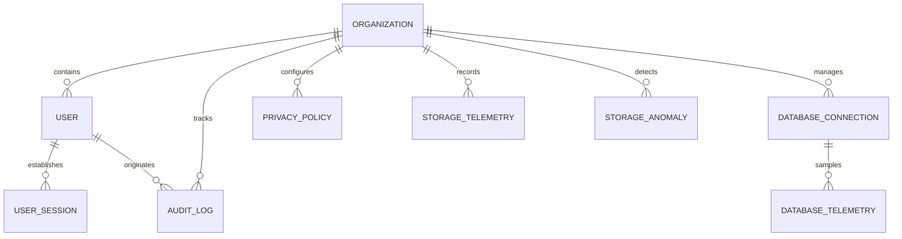

# AEGISSTOR – Database Schema & Data Dictionary

## 1. Database Architecture

AEGISSTOR uses an enterprise SQLAlchemy ORM schema designed for local sovereign persistence (SQLite) with 100% dialect compatibility for production PostgreSQL clusters.

---

## 2. Entity Relationship Diagram (ERD)

---

## 3. Data Dictionary

### 3.1 `organizations`
Represents an enterprise tenant (e.g., hospital wing, bank branch, university campus).
- `id`: Primary key (Integer)
- `name`: Organization display name (String 150)
- `slug`: Unique tenant slug (String 50, indexed)
- `created_at`: Creation timestamp (DateTime)
- `is_active`: Operational flag (Boolean)

### 3.2 `users`
Enterprise user directory with Argon2id authentication and TOTP MFA.
- `id`: Primary key (Integer)
- `org_id`: Tenant foreign key (Integer, indexed)
- `email`: User email address (String 255, unique, indexed)
- `hashed_password`: Argon2id password hash (String 255)
- `full_name`: User name (String 150)
- `role`: RBAC tier: `SUPER_ADMIN`, `DATABASE_ADMIN`, `ANALYST`, `VIEWER`
- `mfa_secret`: Base32 TOTP RFC 6238 secret (String 64, nullable)
- `mfa_enabled`: MFA enforcement flag (Boolean)
- `is_active`: User active status (Boolean)
- `created_at`: Registration timestamp (DateTime)
- `last_login`: Last authenticated timestamp (DateTime, nullable)

### 3.3 `database_connections`
Enterprise database instances monitored by AEGISSTOR.
- `id`: Primary key (Integer)
- `org_id`: Tenant foreign key (Integer, indexed)
- `name`: Connection label (String 100)
- `db_type`: `POSTGRESQL`, `MYSQL`, `SQL_SERVER`, `ORACLE` (String 50)
- `host`: Endpoint hostname or IP (String 255)
- `port`: Connection port (Integer)
- `database_name`: Database or SID name (String 100)
- `username`: Administrative or read-only user (String 100)
- `encrypted_password`: AES-256 Fernet encrypted credential ciphertext (Text)
- `is_active`: Monitoring enabled flag (Boolean)
- `created_at`: Created timestamp (DateTime)
- `last_tested`: Last connection health test (DateTime, nullable)
- `status`: Operational status: `CONNECTED`, `FAILED`, `UNTESTED`

### 3.4 `database_telemetry`
Time-series metadata samples collected from enterprise databases.
- `id`: Primary key (Integer)
- `db_conn_id`: Database connection foreign key (Integer, indexed)
- `timestamp`: Sample timestamp (DateTime, indexed)
- `total_storage_bytes`: Aggregated database size (BigInteger)
- `data_bytes`: Table extent storage (BigInteger)
- `index_bytes`: Index overhead storage (BigInteger)
- `active_connections`: Number of client sessions (Integer)
- `tablespaces_json`: Tablespace usage allocations (Text)
- `largest_tables_json`: Top bloated tables breakdown (Text)
- `largest_indexes_json`: Top index overhead sizes (Text)

### 3.5 `storage_telemetry`
Time-series physical and mounted storage telemetry.
- `id`: Primary key (Integer)
- `org_id`: Tenant foreign key (Integer, indexed)
- `timestamp`: Collection timestamp (DateTime, indexed)
- `drive_name`: Drive letter or device identifier (`C:\`, `D:\`)
- `mount_point`: Mount path
- `filesystem`: NTFS, FAT32, ReFS, exFAT
- `total_bytes`: Total formatted capacity (BigInteger)
- `used_bytes`: Allocated bytes (BigInteger)
- `free_bytes`: Available bytes (BigInteger)
- `usage_percent`: Storage utilization (Float)
- `read_bytes_sec`: Read throughput in bytes/s (Float)
- `write_bytes_sec`: Write throughput in bytes/s (Float)
- `read_ops_sec`: Read IOPS (Float)
- `write_ops_sec`: Write IOPS (Float)
- `disk_health`: Drive status: `OK`, `WARNING`, `FAILING`

### 3.6 `storage_anomalies`
Anomalies detected by the Isolation Forest engine.
- `id`: Primary key (Integer)
- `org_id`: Tenant foreign key (Integer, indexed)
- `resource_type`: `LOCAL_DRIVE` or `ENTERPRISE_DB`
- `resource_identifier`: Drive letter or database name
- `anomaly_type`: `UNUSUAL_GROWTH`, `SUDDEN_DROP`, `INDEX_BLOAT`, `IO_SATURATION`
- `severity`: `LOW`, `MODERATE`, `HIGH`, `CRITICAL`
- `detected_at`: Detection timestamp (DateTime, indexed)
- `anomaly_score`: Isolation Forest outlier score (Float)
- `details`: Explanation and diagnostic metrics (Text)
- `is_acknowledged`: Acknowledged by administrator (Boolean)

### 3.7 `privacy_policies`
Tenant data minimization and retention configuration.
- `id`: Primary key (Integer)
- `org_id`: Tenant foreign key (Integer, unique)
- `data_minimization_mode`: Enforces zero content inspection (Boolean)
- `mask_identifiers`: Hashes identifiers in audit logs (Boolean)
- `retention_days`: Telemetry lifespan before automated purge (Integer, default 30)
- `enforce_tenant_isolation`: Cross-tenant boundary check (Boolean)
- `credential_encryption_active`: AES-256 verification flag (Boolean)
- `audit_level`: `STANDARD` or `DETAILED`
- `updated_at`: Modification timestamp (DateTime)

### 3.8 `audit_logs`
Tamper-evident audit trail for enterprise governance.
- `id`: Primary key (Integer)
- `org_id`: Tenant foreign key (Integer, indexed)
- `user_id`: Authenticated user ID (Integer, nullable)
- `user_email`: Authenticated user email (String 255)
- `timestamp`: Audit event timestamp (DateTime, indexed)
- `action_type`: Audit category (String 50)
- `resource`: Affected drive, table, or user (String 255)
- `description`: Detailed action description (Text)
- `status`: `SUCCESS`, `DENIED`, `FAILED`
- `ip_address`: Client IP address (String 45)
